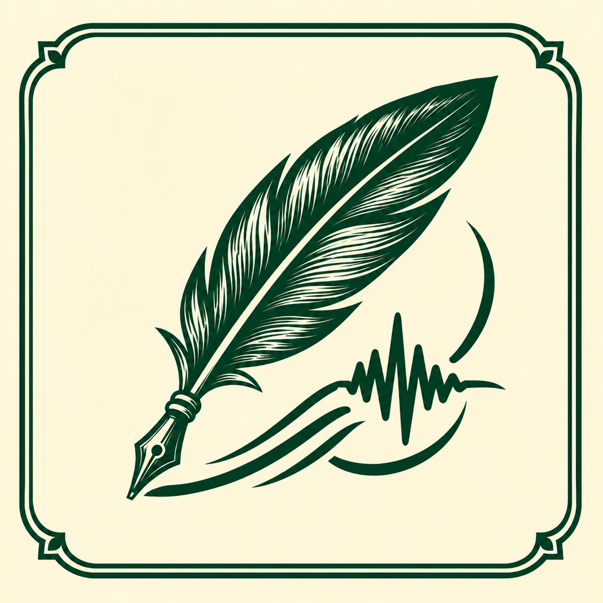

<p align="center"></p>
<h1 align="center">L'écho</h1>
<p align="center">French lectures, local transcription, live Chinese captions.</p>

[简体中文](README.zh-CN.md) · [Downloads](https://github.com/Arthu467587/Lecho/releases) · [Privacy](docs/privacy.md)

L'écho is a native iPad classroom app based on [Clair](https://github.com/steinyanaa/Clair). It uses Apple's on-device French speech recognition and your own DeepSeek API key for Chinese translation, with mathematics/physics terminology, a cream paper interface and forest-green accents.

## Features

- Comma-first streamed captions, short unpunctuated fallback chunks, then contextual merging without clearing already displayed Chinese.
- Pause, save and resume the same class; notes, bookmarks, corrections and a continuous timeline. Optional recordings use separate audio parts rather than overwriting prior sessions.
- Background microphone listening, persistent font sizes, bilingual/French/Chinese display modes and optional small ambiguity hints.
- Classroom search, swipe-to-trash, recovery and confirmed permanent deletion.
- Audio import, playback, targeted retranslation after source edits, AI notes and Markdown/SRT/JSON/audio exports.

## Requirements

- A supported physical iPad running iPadOS 26 or later, with Apple's French speech resources.
- Network access and a user-provided DeepSeek API key for Chinese translation/review/AI notes. No OpenAI API integration.
- A compatible Mac/Xcode to build from source.

## Install a release

Download `Lecho-1.3.0-unsigned.ipa` from [Releases](https://github.com/Arthu467587/Lecho/releases). It is unsigned: use a compatible signing/sideloading tool or app container. No signing certificate or key is supplied. Compatibility and renewal depend on that tool; this project does not guarantee a particular container or permanent signing.

Enter your own DeepSeek API key and course terms in the app. API requests consume your balance.

## Build an IPA

```sh
git clone https://github.com/Arthu467587/Lecho.git
cd Lecho
bash scripts/build-sideload-ipa.sh
```

The script builds an arm64 iPad device target with code signing disabled, validates its Mach-O platform, stages `Payload/L'écho.app`, verifies the ZIP and selects the resulting unsigned IPA in Finder. This build step does not require a paid developer membership or a connected iPad.

To package the most recent completed script build without rebuilding:

```sh
bash scripts/build-sideload-ipa.sh --reuse-latest
```

Alternatively open `L'écho.xcodeproj`, select scheme **L'écho**, and sign/run through Xcode. Retain your original signing identity and Bundle Identifier when updating an existing installation; export important classes first.

## Tests and limitations

See [validation](docs/validation.md) for the 32 portable checks, 6 simulated packaging-flow tests and native-check commands. The v1.3.0 archive was built on a Mac, but complete device behavior and translation quality are still being validated. Short clauses increase responsiveness and can increase API request count; no fixed subtitle latency or accuracy is promised.

## License and credits

MIT — see [LICENSE](LICENSE). Based on **Clair by steinyanaa**; its MIT notice is retained in [LICENSE-Clair.txt](LICENSE-Clair.txt) and [NOTICE](NOTICE). See [architecture](docs/architecture.md) and [branding](docs/branding.md).
